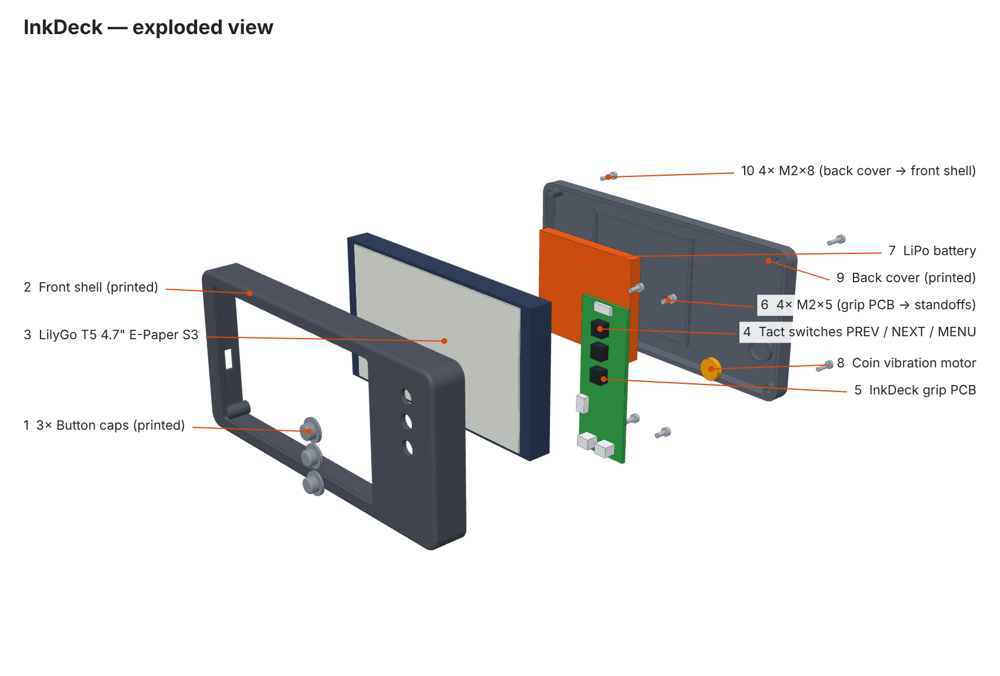

# InkDeck Enclosure: Assembly Guide



The numbers below match the labels in the exploded view. The outer size is **153 × 72 × 23.5 mm**.

## Parts

| # | Part | Type | Qty | Notes |
|---|---|---|---|---|
| 1 | Button caps | Printed | 3 | Plungers that press the tact switches; flange stops them falling out |
| 2 | Front shell | Printed | 1 | Screen window, 3 button holes, grip-PCB standoffs, edge cut-outs |
| 3 | LilyGo T5 4.7" E-Paper S3 | Bought | 1 | ESP32-S3 + 960 × 540 e-paper + microSD |
| 4 | 6 × 6 mm tact switches | Bought | 3 | PREV / NEXT / MENU, soldered on the grip PCB |
| 5 | InkDeck grip PCB | Made (JLCPCB) | 1 | Buttons, power switch, motor driver, connectors |
| 6 | M2 × 5 screws | Bought | 4 | Grip PCB → front-shell standoffs |
| 7 | LiPo battery, ~60 × 50 × 6 mm | Bought | 1 | Sits in the fence in the back cover |
| 8 | 10 mm coin vibration motor | Bought | 1 | Glued into the ring in the back cover, behind the grip |
| 9 | Back cover | Printed | 1 | Battery fence, motor ring, grip ridge |
| 10 | M2 × 8 screws | Bought | 4 | Back cover → front-shell corner bosses |
| — | M2 heat-set inserts | Bought | 8 | 4 in the PCB standoffs, 4 in the corner bosses |
| — | JST-SH 6-pin cable | Bought | 1 | Grip PCB J3 → LilyGo GPIOs |
| — | JST-PH 2-pin cable | Bought | 1 | Grip PCB J2 → LilyGo battery socket |
| — | Thin foam pad | Bought | 1 | Between battery and LilyGo, holds it in place |

## How it fits together

```
FRONT ──────────────────────────────────────────────▶ BACK
1 Button caps   2 Front shell   3 LilyGo (left)      6 M2×5    7 Battery   9 Back cover   10 M2×8
                                5 Grip PCB (right)              8 Motor
                                4 switches face the caps
```

- The **LilyGo** sits screen-down in the left part of the front shell, behind the window.
- The **grip PCB** sits beside it on the right, on 4 standoffs. Its switches face forward and line up with the **button caps** in the holes.
- The **battery** sits behind the LilyGo, and the **motor** behind the grip. Both are held in the back cover.
- The **power switch** lever pokes out of the slot in the top edge, **USB-C** is reachable on the left edge, and the **microSD** and LilyGo's own buttons are on the bottom edge.

## Assembly steps

**Before you start:** press the 8 M2 heat-set inserts into the 4 grip-PCB standoffs and the 4 corner bosses of the front shell, using a soldering iron at about 220 °C (PLA) or 245 °C (PETG).

1. **Button caps.** Lay the front shell face-down and drop the **3 caps (1)** into the button holes from the inside, flange down.
2. **Display.** Lay the **LilyGo (3)** screen-down in the left pocket, with its USB-C facing the left-edge cut-out.
3. **Grip PCB.** Place the **grip PCB (5)** switch-side-down on the standoffs, so the **switches (4)** sit on the caps and the power switch lever goes into the top slot. Fix it with **4 × M2×5 (6)**.
4. **Wire up.**
   - **J3 → LilyGo:** solder or plug the 6-pin cable to the LilyGo's IO10, IO39, IO45, IO48, 3V3 and GND (see the pin table in `firmware/FIRMWARE.md`).
   - **J2 → LilyGo battery socket:** 2-pin JST-PH cable. **Check that red goes to +** before plugging in.
5. **Motor.** Glue the **motor (8)** into the ring in the back cover and solder its two wires to the M1 pads on the grip PCB.
6. **Battery.** Plug the **battery (7)** into J1 on the grip PCB, put the foam pad on the back of the LilyGo, and lay the battery in the back cover's fence.
7. **Close.** Fit the **back cover (9)** and fix it with **4 × M2×8 (10)**.
8. **Test.** Slide the power switch on and press MENU. The motor should buzz and the library should appear.

## Why components sit where they do

| Component | Location | Reason |
|---|---|---|
| Grip PCB + buttons | Right side, under your thumb | One-handed page turning |
| Battery | Behind the screen | Keeps the case narrow; the biggest flat area |
| Motor | Behind the grip | You feel the buzz right where your hand is |
| Power switch | Top edge | Easy to reach, hard to bump by accident |
| USB-C | Left edge | Away from the hand holding the grip |

## Files

| File | What |
|---|---|
| `inkdeck_front_shell / back_cover / button_cap .step/.stl` | Printable parts (print 3 caps) |
| `inkdeck_exploded_assembly.step` | Coloured exploded assembly (opens in Fusion 360) |
| `inkdeck_assembled_assembly.step` | Coloured assembled model |
| `images/inkdeck-exploded.png` | Labelled exploded view |
| `images/inkdeck-exploded-rear.png` | Exploded view from behind |
| `images/inkdeck-assembled.png` | Assembled render |
| `images/inkdeck-drawing.png` | Dimensioned drawing |
| `enclosure.py`, `exploded.py` | Parametric source (CadQuery) |

> Screen window, USB-C, microSD and battery sizes are placeholders until the real parts are measured. Everything is parametric, so the model and drawings update together.
