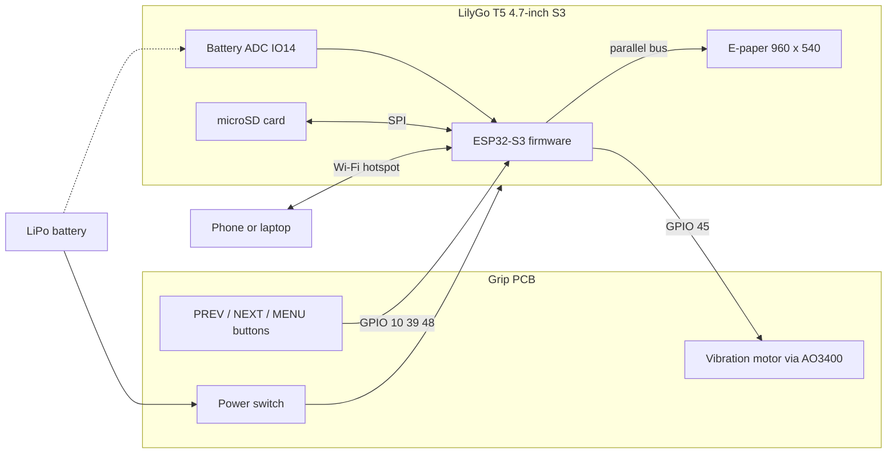

# InkDeck

**A pocket e-paper e-reader with physical page-turn buttons, weeks of battery life, and books loaded over Wi-Fi.**

## What is InkDeck?

InkDeck is a DIY e-reader about the size of a paperback (153 × 72 × 23.5 mm). It has a 4.7" e-paper screen that looks like printed paper, so it's easy on the eyes and readable in sunlight, and it keeps the page on screen even with the power off.

It's built around a **LilyGo T5 4.7" E-Paper S3** board (ESP32-S3 + 960 × 540 e-paper + microSD slot), plus a **custom grip PCB I designed in KiCad**. The grip board sits beside the screen under your right thumb and has:

- **3 buttons**: PREV, NEXT and MENU
- **A coin vibration motor** for a little buzz on each page turn
- **A slide power switch** between the battery and the LilyGo

It reads **EPUB** and **.txt** books from the microSD card, and you can add books from your phone over Wi-Fi without taking the card out. Everything fits in a 3D-printed case I modelled in Fusion 360.

---

## Why I built it

I like reading on e-paper, but most e-readers only work properly with one company's book store, and the cheaper ones only have a touchscreen. I wanted **real buttons** I can press with one thumb while holding it in one hand, like turning a page.

Building it myself means it reads my own DRM-free books (Project Gutenberg, Standard Ebooks) with no account or store. I can also change anything I want, from how long the buttons are held to how the pages look.

It was also a good way to learn about low-power design, which a phone or laptop never makes you think about:
- picking pins that can wake the chip from deep sleep
- dealing with strapping pins
- making e-paper and a battery work together

---

## Features

- 4.7" 960 × 540 e-paper with 16 grey levels: easy to read, and the page stays on screen with zero power
- Reads **EPUB** (converted once, then opens instantly) and **.txt** books
- **Physical buttons**: tap for the next or previous page, hold to jump a chapter
- **Haptic feedback**: a different buzz for page turns, chapter jumps, errors and sleep
- **Deep sleep** after 10 minutes, then MENU wakes it on the same page
- **Wi-Fi upload**: the reader makes its own hotspot, so a phone can add or delete books
- Remembers your page in every book
- Battery % in the footer, and it shows "please charge" and sleeps when nearly flat
- One-handed grip with the buttons under your thumb

---

## How it works



The e-paper, SD card and touch use almost every GPIO on the LilyGo. Only **4 are free**, so the grip PCB uses exactly 4 signals through a 6-pin JST-SH cable:

| J3 pin | Signal | LilyGo | Why this pin |
|---|---|---|---|
| 1 | +3.3V | 3V3 | |
| 2 | GND | GND | |
| 3 | BTN_MENU | IO10 | The only free **RTC pin**, so MENU can wake the chip from deep sleep |
| 4 | BTN_PREV | IO39 | Internal pull-up |
| 5 | MOTOR | IO45 | **Strapping pin**, so the PCB has a 10k pull-down to keep it LOW at boot |
| 6 | BTN_NEXT | IO48 | Internal pull-up |

---

## Controls

| Button | While reading | In the library |
|---|---|---|
| **NEXT / PREV** | Next / previous page | Move down / up |
| **Hold NEXT / PREV** (0.7 s) | Next / previous chapter | Move 5 rows |
| **MENU** | Open the library | Open the book / vibration on or off |
| **Hold MENU 1 s** | Wi-Fi upload mode | Wi-Fi upload mode |
| **Hold MENU 3 s** | Sleep | Sleep |
| **MENU while asleep** | Wake up on the same page | |

While MENU is held, the motor buzzes at 1 s and again at 3 s, so you can feel which action you'll get before letting go.

---

## Firmware

Written in **PlatformIO (Arduino framework)** with LilyGo's e-paper library. The full explanation with diagrams and code snippets is in **[firmware/FIRMWARE.md](firmware/FIRMWARE.md)**.

| File | What it does |
|---|---|
| `config.h` | Every pin and setting in one place |
| `buttons.h` | Debounced buttons: tap, hold and long press |
| `haptic.h` | Vibration patterns |
| `epub.cpp` | Turns an EPUB into plain text |
| `main.cpp` | Screens, page layout, Wi-Fi upload, sleep and the main loop |

**EPUB reader:** an EPUB is a ZIP file full of web pages. The first time a book is opened, the firmware:
1. reads the ZIP's file list
2. finds `content.opf` (title + chapter order)
3. unzips each chapter with the decoder built into the ESP32-S3's ROM
4. removes the HTML tags and saves plain text to the SD card

After that the book opens instantly. Every chapter starts on a new page.

**Pages:** a greedy word-wrap fills each line with words until the next one doesn't fit. Where every page starts is saved on the SD card, so the footer can show `Ch 3/27   57 / 312   70%` and going back a page is instant.

**Deep sleep:** the e-paper keeps the page visible with no power, so the reader looks the same asleep. MENU wakes it:

```cpp
while (digitalRead(PIN_BTN_MENU) == LOW) delay(10);   // never sleep while MENU is held
esp_sleep_enable_ext0_wakeup(GPIO_NUM_10, 0);         // MENU wakes it up
esp_deep_sleep_start();
```

**Haptics:**

| Buzz | Meaning |
|---|---|
| 1 short | Page turn |
| 2 short | Chapter jump |
| 3 quick | Can't go further |
| 1 long | Going to sleep |

**Testing:** the parts haven't arrived yet, so the EPUB converter and a simulation of the whole firmware (fake buttons, screen and SD card) are tested on a computer, in [`firmware/pc_tests`](firmware/pc_tests).

---

## Custom PCB

Designed in KiCad: a **25 × 67 mm** two-layer grip board that sits beside the LilyGo inside the case. Power is on the front layer, button signals on the back, with ground fill on both sides. It passes DRC with **0 errors, 0 unconnected**.

- **Power:** battery in → slide switch → battery out to the LilyGo's battery socket
- **Buttons:** 3 × 6 mm tact switches. MENU has a 10k pull-up so it still works in deep sleep
- **Motor driver:** AO3400 MOSFET with a 1N4148 flyback diode and a 10k gate pull-down
- **Connector:** 6-pin JST-SH (J3) to the LilyGo GPIOs


---

## Enclosure

Modelled in Fusion 360 with **user parameters**, so it can be updated once the real parts are measured. It's 3 printed parts:

1. **Front shell:** screen window, 3 button holes lined up with the grip PCB, standoffs for the PCB, and cut-outs for the power switch, USB-C and microSD
2. **Back cover:** holds the battery behind the screen and the motor behind the grip, with a raised ridge so it's comfy to hold
3. **Button caps (×3):** plungers that reach the tact switches, with a flange so they can't fall out

The grip is on the right so your thumb reaches the buttons, and USB-C is on the left so the cable doesn't get in the way.

### Exploded view

Shows how the screen, grip PCB, battery, motor, printed parts and screws fit together. The parts list, step-by-step assembly and wiring are in **[CAD/ASSEMBLY.md](CAD/ASSEMBLY.md)**.

### Renders


> The screen window, USB-C, microSD and battery sizes are placeholders and will be checked against the real parts before the final print.

---

## Bill of materials

All parts are from **AliExpress** except the custom PCB, which comes from **JLCPCB**. Prices are **approximate AUD** and change with sales, exchange rates and shipping. Many small parts only come in packs, so you'll have spares. Where a listing has several options (value, size, pin count, pack size), pick the one in the **Part** column.

### Electronics

| # | Part | Qty | Approx. AUD | Link |
|---|---|---|---|---|
| 1 | LilyGo T5 4.7" E-Paper **S3** V2.3 (ESP32-S3, N16R8) | 1 | $65.00 | [AliExpress](https://www.aliexpress.com/item/1005004647326743.html) |
| 2 | 3.7 V LiPo battery, ~2000 mAh, ~60 × 50 × 6 mm (605060), JST-PH 2.0 | 1 | $12.00 | [AliExpress search](https://www.aliexpress.com/w/wholesale-605060-lipo-battery-jst.html) (pick 605060 with a PH 2.0 plug) |
| 3 | 10 mm coin vibration motor, 3 V (pack of 10) | 1 pack | $5.00 | [AliExpress](https://www.aliexpress.com/item/1005007703166995.html) |
| 4 | 6 × 6 mm tact switches (pack of 100) | 1 pack | $3.00 | [AliExpress](https://www.aliexpress.com/item/1005008112405709.html) |
| 5 | SS12D00 mini slide switch (pack of 20) | 1 pack | $3.00 | [AliExpress](https://www.aliexpress.com/item/1005002190531295.html) |
| 6 | AO3400 N-channel MOSFET, SOT-23 (pack of 50) | 1 pack | $3.00 | [AliExpress](https://www.aliexpress.com/item/32855231231.html) |
| 7 | 1N4148 diode (pack of 100) | 1 pack | $2.00 | [AliExpress](https://www.aliexpress.com/item/1005003237310728.html) |
| 8 | 10k resistors, 0805 (pack of 100) | 1 pack | $2.00 | [AliExpress](https://www.aliexpress.com/item/32702695904.html) |
| 9 | JST-SH 1.0 mm 6-pin connectors + pre-crimped cable | 1 set | $5.00 | [AliExpress](https://www.aliexpress.com/item/1005004098040339.html) |
| 10 | JST-PH 2.0 mm 2-pin connectors + pre-crimped cable | 1 set | $4.00 | [AliExpress](https://www.aliexpress.com/item/1005002827963237.html) |
| 11 | microSD card, 8–32 GB | 1 | $8.00 | [AliExpress](https://www.aliexpress.com/item/1005004100092905.html) |
| 12 | Custom grip PCB, 5 pcs + shipping (**JLCPCB**) | 1 order | $18.00 | [JLCPCB](https://jlcpcb.com) (upload the Gerbers in `PCB/`) |
| | **Electronics subtotal** | | **$130.00** | |

### Enclosure

| # | Part | Qty | Approx. AUD | Link |
|---|---|---|---|---|
| 13 | PLA or PETG filament (~80 g of a 1 kg roll) | 1 | $3.00 | [AliExpress](https://www.aliexpress.com/item/1005006789571723.html) |
| 14 | M2 brass heat-set inserts (need 8, pack of 50) | 1 pack | $6.00 | [AliExpress](https://www.aliexpress.com/item/1005005109518603.html) |
| 15 | M2 screw assortment (4× M2×5, 4× M2×8) | 1 kit | $6.00 | [AliExpress](https://www.aliexpress.com/item/32770172952.html) |
| 16 | Thin double-sided foam tape (holds the battery) | 1 roll | $3.00 | [AliExpress](https://www.aliexpress.com/item/1005001168622872.html) |
| | **Enclosure subtotal** | | **$18.00** | |

### Total

| | AUD |
|---|---|
| Electronics | $130.00 |
| Enclosure | $18.00 |
| **Estimated total** | **≈ $148.00** |

Charging is through the LilyGo's own USB-C port, so any phone charger and USB-C cable works.

> AliExpress listings change often. If a link stops working, search AliExpress for the exact part name in the table (e.g. "LilyGo T5 4.7 S3", "AO3400").

## Repository layout

```
InkDeck/
├── README.md
├── JOURNAL.md               ← build log, day by day
├── PCB/                     ← KiCad project + Gerbers (grip PCB)
├── CAD/
│   ├── ASSEMBLY.md          ← parts list, assembly steps, wiring
│   ├── step/  stl/          ← printable parts + assemblies
│   └── images/              ← exploded view, renders, drawing
└── firmware/
    ├── platformio.ini
    ├── FIRMWARE.md          ← how everything in the code works
    ├── src/                 ← the firmware
    └── pc_tests/            ← EPUB + firmware tests that run on a computer
```

---

---

## Acknowledgements

- [LilyGo](https://lilygo.cc) for the T5 4.7" board and the [LilyGo-EPD47](https://github.com/Xinyuan-LilyGO/LilyGo-EPD47) e-paper library
- Built with [KiCad](https://www.kicad.org/), [Fusion 360](https://www.autodesk.com/products/fusion-360) and [PlatformIO](https://platformio.org/)
- Free books: [Project Gutenberg](https://www.gutenberg.org) and [Standard Ebooks](https://standardebooks.org)
- AI assistance (Claude) was used for planning, guidance, the firmware and its tests.
