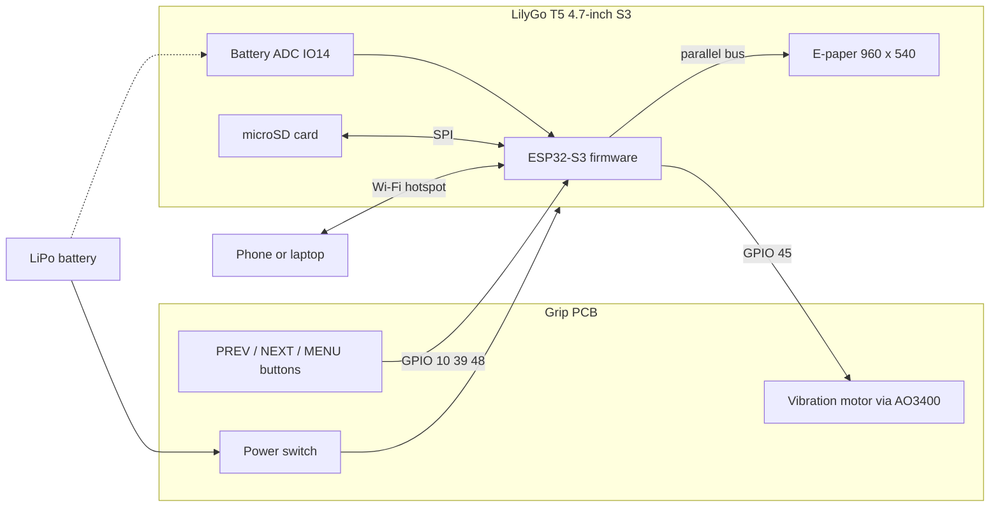
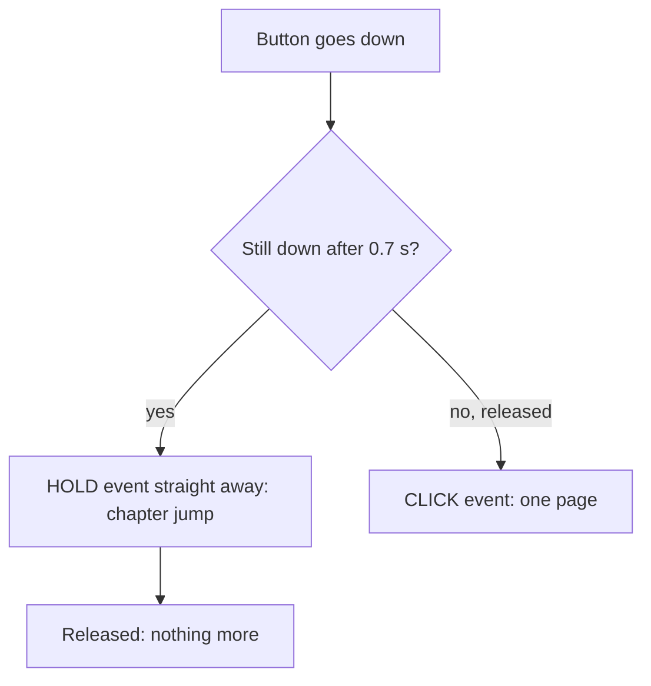
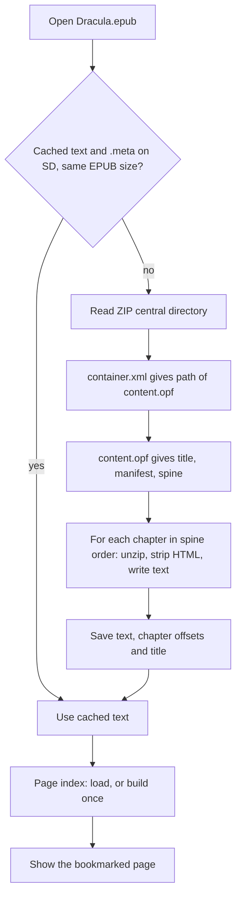
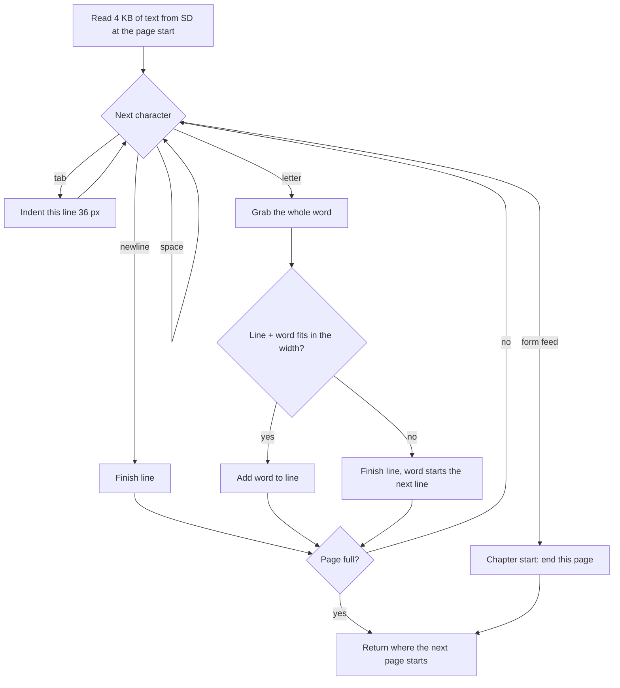
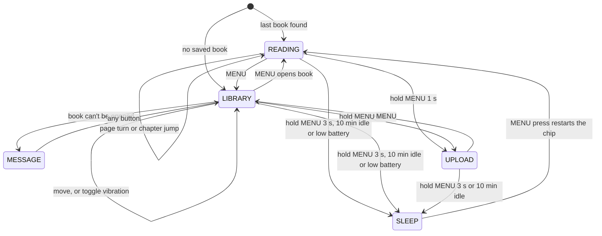
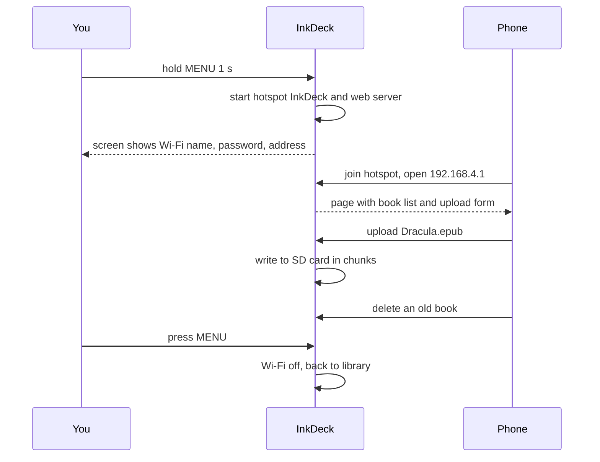

# InkDeck Firmware Guide

This explains how the InkDeck firmware works: the EPUB reader, button handling, haptic feedback, deep sleep, the battery, SD card and e-paper display, and how the reader moves between its modes.

**Stack:** PlatformIO + Arduino framework on the ESP32-S3, with LilyGo's [LilyGo-EPD47](https://github.com/Xinyuan-LilyGO/LilyGo-EPD47) e-paper driver. EPUBs are unzipped with the DEFLATE decoder built into the ESP32-S3's ROM, so no extra library is needed.

| File | What's in it |
|---|---|
| `src/config.h` | Every pin and setting in one place |
| `src/haptic.h` | Vibration patterns |
| `src/buttons.h` | Debounced buttons: click / hold / long-press |
| `src/epub.h`, `src/epub.cpp` | EPUB → plain-text converter (no Arduino code, so it's tested on a PC) |
| `src/main.cpp` | Screens, books, page layout, Wi-Fi upload, sleep, main loop |
| `pc_tests/` | PC tests: the EPUB converter, plus a simulation of the whole firmware |

---

## Contents

1. [Overview](#1-overview)
2. [Hardware & pin map](#2-hardware--pin-map)
3. [Controls](#3-controls)
4. [Buttons](#4-buttons)
5. [Haptic feedback](#5-haptic-feedback)
6. [EPUB reader](#6-epub-reader)
7. [Turning text into pages](#7-turning-text-into-pages)
8. [E-paper display](#8-e-paper-display)
9. [Modes (state machine)](#9-modes-state-machine)
10. [Deep sleep, wake & battery](#10-deep-sleep-wake--battery)
11. [Wi-Fi upload](#11-wi-fi-upload)
12. [SD card layout](#12-sd-card-layout)
13. [Testing on a PC](#13-testing-on-a-pc)
14. [Build & flash](#14-build--flash)
15. [Troubleshooting](#15-troubleshooting)

---

## 1. Overview



| Job | How |
|---|---|
| **Read books** | Opens `.epub` and `.txt` files from microSD. EPUBs are converted to text once, then cached |
| **Navigate** | 3 buttons: page turns, chapter jumps, library, settings |
| **Feedback** | Different vibration patterns for page turns, chapter jumps, errors and sleep |
| **Save power** | Deep sleep after 10 min idle, on a 3 s MENU hold, or when the battery is nearly flat. The page stays visible with zero power |
| **Add books** | Wi-Fi upload mode: the reader makes its own hotspot and serves a web page to add and delete books |

---

## 2. Hardware & pin map

All pins are set in `config.h`.

| Signal | ESP32 pin | Grip PCB | Notes |
|---|---|---|---|
| MENU button | IO10 | J3-3 | 10k pull-up on PCB, **RTC pin → can wake from deep sleep** |
| PREV button | IO39 | J3-4 | Internal pull-up |
| NEXT button | IO48 | J3-6 | Internal pull-up |
| Motor (MOSFET gate) | IO45 | J3-5 | **Strapping pin**, 10k pull-down on PCB keeps it LOW at boot |
| 3.3 V / GND | n/a | J3-1 / J3-2 | From the LilyGo |
| Battery voltage | IO14 | n/a | On the LilyGo, 1:2 divider |
| SD MISO / MOSI / SCK / CS | 16 / 15 / 11 / 42 | n/a | On the LilyGo |

Only 4 GPIOs are free on the LilyGo (10, 39, 45, 48). Everything else is used by the e-paper, SD card, touch and I2C, which is why the grip PCB uses exactly 4 signals.

---

## 3. Controls

| Button | While reading | In the library |
|---|---|---|
| **NEXT** | Next page | Move down |
| **PREV** | Previous page | Move up |
| **Hold NEXT** (0.7 s) | Next chapter (`.txt`: forward 10 pages) | Move down 5 |
| **Hold PREV** (0.7 s) | Start of this chapter, then the previous one | Move up 5 |
| **MENU** | Open the library | Open the book / switch vibration on or off |
| **Hold MENU 1 s** | Wi-Fi upload mode | Wi-Fi upload mode |
| **Hold MENU 3 s** | Sleep | Sleep |
| **MENU while asleep** | Wake up on the same page | |

---

## 4. Buttons

`buttons.h` has one `Button` class used for all three buttons.

### Debouncing

When a switch is pressed, its contacts "bounce" (flicker on and off) for a few milliseconds. Without debouncing, one press could turn several pages. A new state only counts once the pin has stayed the same for **25 ms**:

```cpp
int r = digitalRead(pin_);
if (r != raw_) { raw_ = r; changedAt_ = now; }        // still bouncing: restart the timer
if (raw_ != stable_ && now - changedAt_ >= DEBOUNCE_MS) {
  stable_ = raw_;                                      // stable for 25 ms -> accept it
  ...
}
```

All buttons are **active-LOW**: pressing connects the pin to GND, so pressed = `LOW`.

### Click vs hold (PREV / NEXT)



`HOLD` fires **while you're still holding**, so the chapter jump starts straight away. When you then let go, no `CLICK` is sent, so a hold never also turns a page.

### MENU: one button, three jobs

| Hold time | Event | Action | What you feel |
|---|---|---|---|
| < 1 s | `BTN_CLICK` | Library / open book / leave upload mode | |
| 1–3 s | `BTN_LONG` | Wi-Fi upload mode | 1 pulse at 1 s |
| > 3 s | `BTN_VLONG` | Sleep now | 2nd pulse at 3 s |

While MENU is held, the motor gives a **cue pulse** at 1 s and again at 3 s, so you can feel which action you'll get before letting go:

```cpp
if (cues_ == 0 && held >= MENU_LONG_MS)  { cues_ = 1; haptic::play(CUE); }
if (cues_ == 1 && held >= MENU_VLONG_MS) { cues_ = 2; haptic::play(CUE); }
```

MENU acts on **release**, never while held. Wake-from-sleep watches for MENU = LOW, so going to sleep while it's still held would wake the reader straight away.

**Wake press is ignored:** if a button is already down when `begin()` runs (MENU just woke the reader), it's ignored until released, so waking up doesn't also open the library.

**Why MENU has a real resistor:** the normal internal pull-ups switch off in deep sleep. MENU is the wake button, so it has a 10k pull-up on the PCB (and the firmware also turns on the RTC pull-up before sleeping, as a backup).

---

## 5. Haptic feedback

A 10 mm coin vibration motor, switched by an AO3400 MOSFET on IO45 (`haptic.h`). Each action has its own feel, so you know what happened without looking at the screen:

| Pattern | Feel | Meaning |
|---|---|---|
| `TICK` | 1 short pulse (20 ms) | Page turn, library move, woke up |
| `DOUBLE` | 2 pulses | Jumped a whole chapter |
| `CUE` | 1 medium pulse (45 ms) | MENU hold reached 1 s / 3 s |
| `ERROR_BUZZ` | 3 quick pulses | Can't go further (first/last page), or a book couldn't open |
| `SLEEP_BUZZ` | 1 long pulse (120 ms) | Going to sleep |

```cpp
inline void play(HapticPattern p) {
  if (!enabled()) return;                 // vibration can be switched off in the library
  switch (p) {
    case TICK:   pulse(20); break;
    case DOUBLE: pulse(20); delay(70); pulse(20); break;
    ...
  }
}
```

- **On/off setting:** the last row of the library is **Vibration: on/off**. It's saved in `Preferences` (flash), so it survives sleep and restarts.
- **Why IO45 needs care:** it's a *strapping pin*. If it's HIGH while the chip boots, the flash gets the wrong voltage and the board won't start. The 10k pull-down on the PCB holds it LOW, and `haptic::begin()` drives it LOW as the very first thing in `setup()`.
- **Why it's OK that patterns block:** they last at most ~150 ms, and the e-paper refresh that follows takes about a second anyway. The motor is always off before the display starts drawing, so the two never pull current at the same time.

---

## 6. EPUB reader

An EPUB is a **ZIP file full of web pages**:

```
book.epub (ZIP)
├── mimetype                    "application/epub+zip"
├── META-INF/container.xml      -> says where the .opf file is
└── OEBPS/
    ├── content.opf             -> title, list of files, reading order
    ├── chapter1.xhtml          -> the text, as HTML
    └── images, CSS, fonts ...  (ignored: e-paper shows text only)
```

The ESP32 can't lay out HTML on the fly fast enough for page turns, so the **first time** a book is opened, `epub.cpp` converts it to plain text and saves it to the SD card. After that it opens instantly.



### Step 1: the ZIP directory

A ZIP ends with a **central directory**: a list of every file inside, with its size, compression and where its data starts. The converter finds it by searching backwards for its signature (`0x06054b50`), reads the list once, then jumps straight to the files it needs.

### Step 2: unzipping a chapter

Most chapters are compressed with **DEFLATE**. The ESP32-S3 has a DEFLATE decoder (*miniz tinfl*) **built into its ROM**, so it costs no flash space. The ZIP directory says exactly how big each chapter is once unpacked, so it's a single call:

```cpp
bool romInflate(const uint8_t* in, size_t inLen, uint8_t* out, size_t outLen) {
  tinfl_decompressor* d = (tinfl_decompressor*)malloc(sizeof(tinfl_decompressor));
  tinfl_init(d);
  size_t inBytes = inLen, outBytes = outLen;
  tinfl_status st = tinfl_decompress(d, in, &inBytes, out, out, &outBytes,
                                     TINFL_FLAG_USING_NON_WRAPPING_OUTPUT_BUF);
  free(d);
  return st == TINFL_STATUS_DONE && outBytes == outLen;
}
```

Chapters are unpacked into **PSRAM** (8 MB), and anything over 4 MB is refused to protect memory.

### Step 3: the OPF (title + reading order)

`content.opf` has three parts the reader uses:

```xml
<dc:title>Dracula</dc:title>                                       <!-- shown in the footer + library -->
<item id="c1" href="Text/chapter1.xhtml" media-type="application/xhtml+xml"/>   <!-- manifest -->
<itemref idref="c1"/>                                              <!-- spine = reading order -->
```

Links are resolved relative to the OPF's folder, including `../` and `%20` (spaces): `resolvePath("OEBPS/Text/", "../Images/a%20b.png")` → `OEBPS/Images/a b.png`. These are skipped:
- `linear="no"` items (extra pages that aren't part of the main reading order)
- the EPUB 3 contents page (`properties="nav"`), since chapter jumps do that job
- pages with no text (e.g. a cover that's only a picture)

### Step 4: HTML → text

`htmlToText()` walks through the HTML once. Tags aren't drawn; they decide where breaks go:

| HTML | Becomes |
|---|---|
| `<p>` | New line + `\t` (indented paragraph) |
| `<h1>`–`<h6>` | Blank line before and after |
| `<br>` | New line |
| `<li>` | New line + `- ` |
| `<hr>` | `* * *` on its own line |
| `<div>`, `<blockquote>`, `<section>` … | New line |
| `<head>`, `<script>`, `<style>`, `<svg>`, comments | Skipped completely |
| `&amp;` `&#8217;` `&#x2014;` | Real characters |
| Runs of spaces / newlines | One space (like a browser) |
| Soft hyphens, zero-width spaces | Removed |

Breaks are **pending**: `</p>` doesn't write `\n` straight away, it just remembers a break is needed and writes it before the next real character. That stops empty `<div>`s from stacking up blank lines.

**Missing characters:** the FiraSans font doesn't have every Unicode character. `fontHasGlyph()` checks the font's character ranges, and anything missing is swapped for something it does have, so you never see blank boxes:

| Missing | Swapped for |
|---|---|
| ‘ ’ “ ” | `'` `"` |
| — | `--` |
| … | `...` |
| é ñ ü (if missing) | e n u |

### Step 5: chapters

Before each chapter the converter writes a `\f` (form feed) character and records where the chapter starts. `\f` makes every chapter **start on a new page**, and the offsets make **chapter jumps** and the "Ch 3/27" footer possible.

### What can't be read

| Book | What happens |
|---|---|
| DRM-protected (most shop-bought books) | "This book has DRM" (detected from `META-INF/encryption.xml`) |
| Not really an EPUB / damaged | "Not a valid EPUB" with the reason |
| Images, tables, fonts | Images skipped, table cells separated by spaces |

Errors show on screen with an error buzz, and any button goes back to the library. Free DRM-free books: [Project Gutenberg](https://www.gutenberg.org), [Standard Ebooks](https://standardebooks.org).

---

## 7. Turning text into pages

### Word-wrap (`layoutPage`)



It's a greedy word-wrap: add words to a line until the next one doesn't fit, then start a new line. Widths are measured in real pixels with the font, so lines fill properly even though letters are different widths. Blank lines at the very top of a page are skipped.

| Character | Meaning |
|---|---|
| `\n` | End of line (two in a row = blank line) |
| `\t` | Paragraph start: first line indented 36 px |
| `\f` | Chapter start: always begins a new page |

**One function does two jobs:**

| Call | Used for |
|---|---|
| `layoutPage(offset, true)` | Showing a page: lays out and draws |
| `layoutPage(offset, false)` | Building the index: lays out without drawing |

Because both use the same code, page breaks always match.

### Page index (`buildIndex` / `loadIndex`)

To show "57 / 312", go **back** a page and jump between chapters, the reader needs to know where every page starts. The first time a book is opened it lays out the whole book once ("Preparing…") and saves the start of every page:

```
/.inkdeck/Dracula.epub.idx
[version][text size][page count][0][2841][5602][8377] ...
```

Next time it just loads that list. If the text changes size, or the layout rules change (`INDEX_VERSION` in `config.h`), the check fails and the index is rebuilt automatically.

### Chapter jumps

Chapter offsets are byte positions in the text; the page index turns them into page numbers with a binary search:

```cpp
int pageOfOffset(uint32_t off) {       // last page that starts at or before `off`
  int lo = 0, hi = totalPages() - 1;
  while (lo < hi) {
    int mid = (lo + hi + 1) / 2;
    if (pages[mid] <= off) lo = mid; else hi = mid - 1;
  }
  return lo;
}
```

**Hold PREV** works like a music player: it goes to the start of the current chapter first, and only goes to the previous chapter if you're already on its first page.

---

## 8. E-paper display

E-paper works very differently from an LCD:

- It **keeps its image with no power**: a page stays visible for weeks while asleep.
- A full update takes about **1 second**, and the screen flashes black/white to clear the old image.

So the firmware **draws everything into a framebuffer in memory first**, then sends the whole page in one go:

```cpp
// 960 x 540 pixels, 4 bits each (16 greys) = 259 KB, so it lives in PSRAM
fb = (uint8_t*)ps_calloc(1, EPD_WIDTH * EPD_HEIGHT / 2);

void showFb() {
  epd_poweron();
  epd_clear();                                       // flash to remove ghosting
  epd_draw_grayscale_image(epd_full_screen(), fb);   // draw the new page
  epd_poweroff();                                    // power only needed while updating
}
```

Text is drawn with the library's **FiraSans** font through two small wrappers, `textWidth()` (measures) and `drawText()` (draws). Long titles are shortened with `fitText()`, which cuts whole characters (accented letters are 2 bytes in UTF-8, so it never cuts one in half).

**Footer:** `The Lighthouse Keeper's Daug...      Ch 2/5    10 / 53   70%`

---

## 9. Modes (state machine)



`loop()` reads all three buttons once, then a `switch (mode)` decides what each one does in the current mode:

```cpp
case READING:
  if (next == BTN_CLICK) {
    if (pageNo < totalPages() - 1) { haptic::play(TICK); pageNo++; renderPage(); }
    else haptic::play(ERROR_BUZZ);                      // last page
  }
  if (next == BTN_HOLD || prev == BTN_HOLD) {
    int target = chapterJumpTarget(next == BTN_HOLD ? +1 : -1);
    if (target != pageNo) { haptic::play(DOUBLE); pageNo = target; renderPage(); }
    else haptic::play(ERROR_BUZZ);
  }
  if (menu == BTN_CLICK) { mode = LIBRARY; renderLibrary(); }
  if (menu == BTN_LONG)  { startUpload(); }
  break;
```

The same buttons do different things in different modes, which is how 3 buttons control everything.

---

## 10. Deep sleep, wake & battery

### Going to sleep

```cpp
void goToSleep() {
  haptic::play(SLEEP_BUZZ);                           // long buzz = "going to sleep"
  while (digitalRead(PIN_BTN_MENU) == LOW) delay(10); // never sleep with MENU held
  digitalWrite(PIN_MOTOR, LOW);
  epd_poweroff_all();                                 // display driver fully off
  rtc_gpio_pullup_en(GPIO_NUM_10);                    // backup pull-up for MENU
  esp_sleep_enable_ext0_wakeup(GPIO_NUM_10, 0);       // wake when MENU goes LOW
  esp_deep_sleep_start();                             // never returns
}
```

| Trigger | Where |
|---|---|
| Hold MENU 3 s | `loop()`, any mode |
| 10 minutes with no button pressed | `loop()` checks `lastActivity` |
| Battery ≤ 3 % | Checked on every screen update; shows "Battery low, please charge" first |
| No SD card | `setup()` shows a message and sleeps; MENU tries again |

- In deep sleep the ESP32 uses microamps, and the **page stays on the e-paper**, so it looks like a paper book.
- Only RTC pins can wake the chip. **IO10 is the only free RTC-capable pin**, which is why MENU is on IO10.

### Waking up

Waking **restarts the chip from `setup()`**, which checks *why* it started:

```cpp
bool wokeByButton = esp_sleep_get_wakeup_cause() == ESP_SLEEP_WAKEUP_EXT0;
if (last.length() && SD.exists(last) && loadBook(last) == "") {
  mode = READING;
  if (wokeByButton) haptic::play(TICK);   // page is still on screen: skip the redraw
  else renderPage();
}
```

Skipping the redraw saves a full-screen flash and some battery. RAM is lost in deep sleep, so state is kept elsewhere:

| What | Where |
|---|---|
| Which book is open | `Preferences` (flash) |
| Vibration on/off | `Preferences` (flash) |
| Page number | `.pos` file on the SD card, saved on every page turn |

### Battery level

The LiPo voltage reaches IO14 through a 1:2 divider on the LilyGo. That divider is only powered while the display's power rail is on, so `batteryPercent()` switches the rail on just for the reading:

```cpp
epd_poweron();
float v = analogReadMilliVolts(PIN_BAT_ADC) * 2 / 1000.0;   // x2 undoes the divider
epd_poweroff();
if (v < 2.5) return -1;                                     // no battery: footer shows "USB"
return constrain((int)((v - 3.3) / (4.15 - 3.3) * 100), 0, 100);
```

It's a straight-line estimate (LiPo voltage isn't perfectly linear), which is close enough for a reader.

---

## 11. Wi-Fi upload

Wi-Fi is **off** while reading (a big battery saving). Holding MENU for 1 s starts upload mode:



Uploads are written to the SD card **in chunks as they arrive**, so even big books never need to fit in RAM:

```cpp
if (up.status == UPLOAD_FILE_START) {
  String fn = fileName(up.filename);                   // some browsers send a whole path
  if (!(isEpub(fn) || isTxt(fn))) { uploadMsg = "Only .epub and .txt files can be added."; return; }
  uploadFile = SD.open("/" + fn, FILE_WRITE);
} else if (up.status == UPLOAD_FILE_WRITE) uploadFile.write(up.buf, up.currentSize);
else if (up.status == UPLOAD_FILE_END)     { uploadFile.close(); scanBooks(); }
```

- Only `.epub` and `.txt` are accepted, and characters FAT can't store (`: * ? " < > |`) become `_`.
- Uploading a book with the same name replaces it and clears its old caches.
- A half-finished upload (connection lost) is deleted.
- Each book in the list has a **Delete** button, which also removes its caches.

---

## 12. SD card layout

| Path | What |
|---|---|
| `/*.epub`, `/*.txt` | Books (files starting with `.` are hidden) |
| `/.inkdeck/<file>.txt` | Converted text (EPUB only) |
| `/.inkdeck/<file>.meta` | Title + chapter offsets (EPUB only) |
| `/.inkdeck/<file>.idx` | Page index |
| `/.inkdeck/<file>.pos` | Bookmark (last page read) |

Deleting the `.inkdeck` folder is always safe: everything in it is rebuilt when a book is opened.

---

## 13. Testing on a PC

The parts I could test without the hardware are tested on a normal computer (`pc_tests/` folder):

| Test | What it checks |
|---|---|
| `test_epub.cpp` | The EPUB converter on 5 test books: one made by the `ebooklib` library, a hand-made EPUB 2 with odd formatting, one made with `zip` from a pipe (sizes only in the directory), a DRM book and a fake EPUB |
| `run_sim.sh` | Runs the **real `main.cpp`** with fake buttons, screen, SD card and motor. It opens books, turns pages, jumps chapters, sleeps and wakes, uploads a book and toggles vibration, then checks the result after each step |

```
cd pc_tests
python3 make_test_books.py
g++ -std=c++17 -I../src test_epub.cpp ../src/epub.cpp -lz -o test_epub && ./test_epub
./run_sim.sh
```

What the simulation can't check: the real e-paper driver, real font widths, the ROM unzip function and the real button/motor timing. Those need testing on the LilyGo.

---

## 14. Build & flash

1. Install **VS Code** with the **PlatformIO** extension.
2. Open the `firmware/` folder as a project.
3. Plug in the LilyGo with USB-C and click **Upload** (→).
4. Put `.epub` / `.txt` books in the root of a FAT32 microSD card, or upload them over Wi-Fi.
5. Open the Serial Monitor (115200) to see EPUB conversion progress.

---

## 15. Troubleshooting

| Problem | Likely cause | Fix |
|---|---|---|
| Compile error at `miniz.h` / `tinfl_decompress` | Different platform version | Use the version pinned in `platformio.ini` (`espressif32@6.5.0`); the code looks for both `esp32s3/rom/miniz.h` and `rom/miniz.h` |
| Compile error at `font->intervals` | LilyGo library font format changed | Make `fontHasGlyph()` return `cp < 0x7F`, which keeps the text ASCII-only |
| Compile error at `get_text_bounds` / `writeln` | LilyGo library version changed | Check the library's `esp32s3` examples; only `textWidth()` and `drawText()` need updating |
| "This book has DRM" | Shop-bought book | Use DRM-free books |
| First open of a book is slow | Converting + building the page index | Normal, it only happens once per book |
| Strange characters | Font is missing a character | Add it to `fallbackFor()` in `epub.cpp` |
| "No microSD card found" | Card missing or not FAT32 | Format as FAT32 (32 GB or smaller), press MENU |
| Board won't boot with the grip PCB connected | IO45 pulled HIGH at boot | Check the 10k pull-down on the motor MOSFET gate |
| Won't wake from sleep | MENU pull-up missing | Check the 10k from BTN_MENU to 3.3 V |
| Page turns twice per press | Bouncy switch | Raise `DEBOUNCE_MS` in `config.h` |
| Battery % wrong | Divider ratio or range | Compare with a multimeter, then adjust `3.3` / `4.15` |
